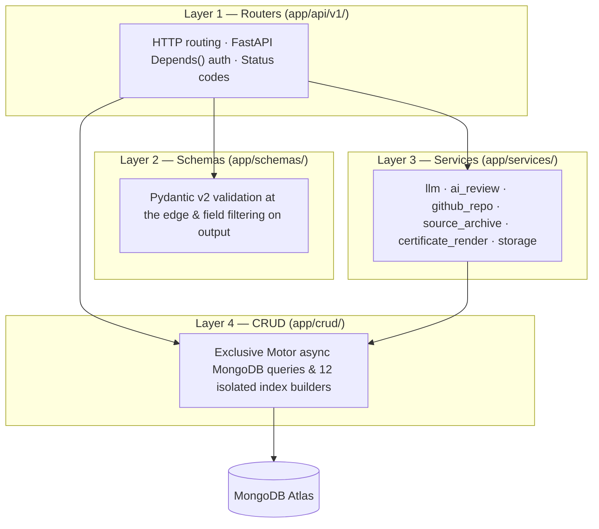
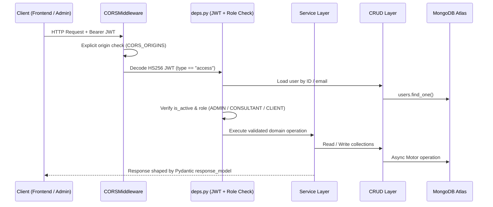
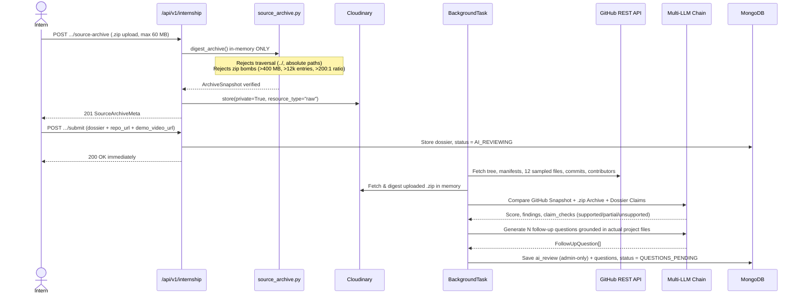
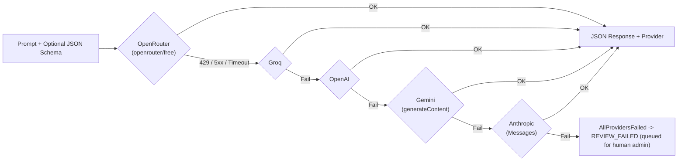
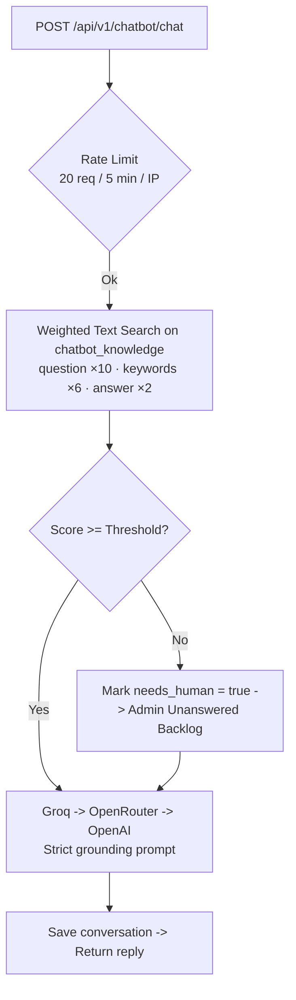

# Turnpike Backend — FastAPI Enterprise & Internship API

> **Async FastAPI + MongoDB Motor backend** powering **Turnpike Frontend**, **Turnpike Admin**, the **dual-source AI internship verification pipeline**, **grounded support assistant**, and **automated PDF certificate engine**. Deployed to **Render**.

> **Full System Design (All Actors, Frontend, Admin & Data Flows):** [ARCHITECTURE.md](./ARCHITECTURE.md)  
> **Deployment Runbook:** [DEPLOYMENT.md](./DEPLOYMENT.md)

---

## Repository Layout

```text
app/
├── main.py                         # FastAPI app, lifespan, 12 index builders, 15 routers, /uploads
├── core/
│   ├── config.py                   # Pydantic v2 settings (env knobs, AI chains, Cloudinary, Firebase)
│   └── security.py                 # Passlib bcrypt hashing, HS256 access/refresh JWT encode/decode
├── api/
│   ├── deps.py                     # get_current_user, _active_user, _admin, require_roles
│   └── v1/                         # 15 domain FastAPI routers
├── schemas/                        # Pydantic v2 request/response contracts (outbound field filter)
├── crud/                           # Exclusive MongoDB Motor async access layer & index builders
├── services/                       # Pure HTTP-free domain services:
│   ├── llm.py                      # Multi-provider fallback chain (OpenRouter, Groq, OpenAI, Gemini, Anthropic)
│   ├── ai_review.py                # Dual-source prompts, claim checks & project-specific questions
│   ├── github_repo.py              # Bounded public GitHub repo snapshot fetcher
│   ├── source_archive.py           # In-memory .zip archive validator & digest (zip-slip/zip-bomb guards)
│   ├── certificate_render.py       # Dynamic Pillow PDF renderer + TA-YYYY-XXXXXXXXXX IDs
│   └── storage.py                  # Cloudinary (public + authenticated) / local dev storage
├── models/enums.py                 # UserRole, InternshipStatus, EnrollmentMode, etc.
└── db/mongodb.py                   # AsyncIOMotorClient lifecycle
scripts/                            # Seeders (seed_data, seed_internship, seed_chatbot) & cluster migration
render.yaml                         # Render deployment blueprint
```

---

## 4-Layer Backend Architecture

Each layer calls **only** the layer directly beneath it. Services never import FastAPI `Request` or raise `HTTPException` — they raise domain errors so the same review pipeline works inside both HTTP requests and detached `BackgroundTasks`.



---

## Request Lifecycle, Auth & Super Admin Security



### Authentication & Privilege Safeguards
- **Staff & Admin (`/api/v1/auth/login`):** Email + bcrypt password hash (`OAuth2PasswordRequestForm`), issuing 30-minute access JWTs and 7-day refresh JWTs.
- **Intern Google Sign-In (`/api/v1/auth/google`):** Verifies Firebase ID token (`email_verified == true`), auto-provisions `CLIENT` role only.
- **Public Registration (`/api/v1/auth/register`):** Hardcodes `role = CLIENT` regardless of request body to prevent privilege escalation.
- **Super Administrator Bootstrap (`app/main.py`):** Seeds `SUPER_ADMIN_EMAIL` / `SUPER_ADMIN_PASSWORD` **only** when zero `ADMIN` users exist in MongoDB. Once created, live credentials are managed via `POST /api/v1/account/credentials` (which requires `current_password`).

---

## Dual-Source Internship Verification & AI Pipeline



### Multi-Provider LLM Chain (`app/services/llm.py`)



---

## Grounded Support Assistant & Certificate Engine



- **Certificate Rendering (`certificate_render.py`):** Admin approval requires `demo_verified: true`. Renders dynamic recipient name, project title, duration, issue date, and look-alike-free certificate ID (`TA-<year>-<10 chars>`) onto the active template via **Pillow**, stores the PDF on Cloudinary (`raw`, public), and exposes unauthenticated third-party verification at `GET /api/v1/internship/certificates/verify/{certificate_number}`.

---

## Complete API Surface (15 Routers)

Interactive docs: `/docs` (Swagger UI) and `/redoc` (ReDoc).

| Prefix | Auth | Purpose |
|---|---|---|
| `/api/v1/auth` | Public | Register (`CLIENT`), login, Google Firebase login, refresh token |
| `/api/v1/account` | `ADMIN` | Admin `/me` and password-verified `/credentials` rotation |
| `/api/v1/internship` | Public / `CLIENT` | Tracks, enroll, 4-step submit, `.zip` upload/download, diagram uploads, Q&A, verify |
| `/api/v1/internship/admin` | `ADMIN` | Settings, track CRUD, submission queue, AI reports, approve/decline, templates |
| `/api/v1/chatbot` | Public / `ADMIN` | Rate-limited grounded chat, knowledge CRUD, unanswered backlog, behaviour |
| `/api/v1/users` & `/activity-logs` | `ADMIN` | Staff/user role management & administrative audit trail |
| `/api/v1/services`, `/content`, `/blogs`, `/training`, `/cms`, `/consultants` | Public / Admin | Enterprise catalog, industries, JAMES WEBB & Agent P8, courses, CMS |
| `/api/v1/leads` & `/newsletter` | Public / Staff | Contact enquiries, book-a-call, demo requests, newsletter |

---

## Technologies Used in Turnpike Backend

| Category | Technologies & Libraries |
|---|---|
| **Web Framework & Server** | Python 3.12 · FastAPI `>=0.110` · Uvicorn `[standard]` · `python-multipart` |
| **Database & Validation** | MongoDB Atlas · Motor `>=3.3` (async driver) · Pydantic v2 `>=2.6` · `pydantic-settings` · `email-validator` |
| **Authentication & Security** | `python-jose[cryptography]` (HS256 JWT) · `passlib[bcrypt]` & `bcrypt` · `firebase-admin >=6.5` |
| **AI & External HTTP** | `httpx >=0.27` async HTTP client · OpenRouter · Groq · OpenAI · Google Gemini (`generateContent`) · Anthropic · GitHub REST API |
| **Storage, Archives & PDF** | Cloudinary SDK `>=1.40` · Pillow `>=10.3` (raster sanitization & PDF rendering) · Python `zipfile` (in-memory anti-tamper digest) |

---

## Local Development, Seeding & Cluster Migration

```bash
python -m venv .venv
./.venv/bin/pip install -r requirements.txt
cp .env.example .env
./.venv/bin/uvicorn app.main:app --reload --port 8000
```

```bash
# Seed initial data
python -m scripts.seed_data          # users, services, courses, blogs
python scripts/seed_internship.py    # internship project briefs
python scripts/seed_chatbot.py       # support assistant knowledge base

# Non-destructive MongoDB cluster migration
MIGRATE_SOURCE_URL="mongodb+srv://..." python -m scripts.migrate_database --dry-run
MIGRATE_SOURCE_URL="mongodb+srv://..." python -m scripts.migrate_database
```

---

*Published from the Turnpike Analyst monorepo. See [ARCHITECTURE.md](./ARCHITECTURE.md) for the complete platform blueprint.*
